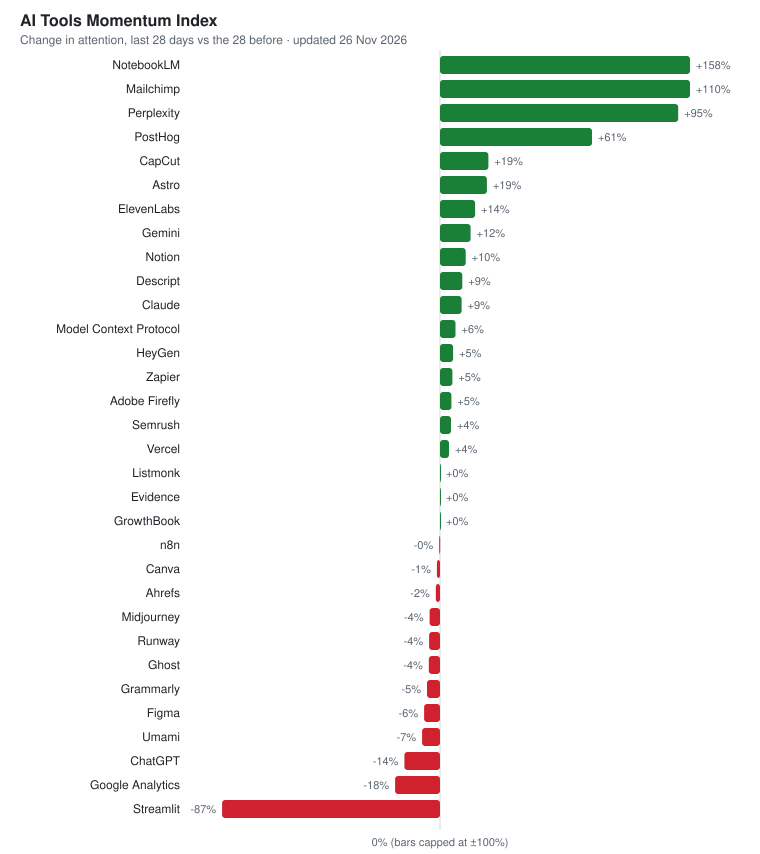

# AI Tools Momentum Index

Which tools on the [Awesome AI Marketing](../README.md) list are gaining attention, and which are cooling off. Rebuilt automatically every Monday by [a GitHub Action](../.github/workflows/momentum.yml); nobody edits these numbers by hand.

**Last updated:** 26 November 2026

**This month's biggest mover:** NotebookLM (+158%). **Cooling off most:** Streamlit (-87%).



| Rank | Tool | Momentum | Wikipedia views (28 days) | Change | HN mentions (28 days) | Change | GitHub stars | Stars gained (28 days) |
| ---: | --- | ---: | ---: | ---: | ---: | ---: | ---: | ---: |
| 1 | NotebookLM | **+158%** | 1,546 | -45% | 118 | +361% | – | – |
| 2 | Mailchimp | **+110%** | 7,210 | +119% | 39 | +100% | – | – |
| 3 | Perplexity | **+95%** | 57,208 | -5% | 253 | +196% | – | – |
| 4 | PostHog | **+61%** | – | – | 57 | +61% | 41,163 | – |
| 5 | CapCut | **+19%** | 26,536 | +24% | 7 | +14% | – | – |
| 6 | Astro | **+19%** | – | – | 13 | +19% | 64,231 | – |
| 7 | ElevenLabs | **+14%** | 29,143 | -7% | 63 | +35% | – | – |
| 8 | Gemini | **+12%** | 3,413 | -4% | 1,654 | +29% | – | – |
| 9 | Notion | **+10%** | 10,515 | -12% | 209 | +33% | – | – |
| 10 | Descript | **+9%** | – | – | 989 | +9% | – | – |
| 11 | Claude | **+9%** | 10,088 | -9% | 8,369 | +27% | – | – |
| 12 | Model Context Protocol | **+6%** | 34,995 | -2% | 14 | +15% | 92,278 | – |
| 13 | HeyGen | **+5%** | 2,256 | -0% | 27 | +11% | – | – |
| 14 | Zapier | **+5%** | 3,267 | -12% | 26 | +21% | – | – |
| 15 | Adobe Firefly | **+5%** | 2,115 | -2% | 5 | +11% | – | – |
| 16 | Semrush | **+4%** | 3,153 | -11% | 5 | +20% | – | – |
| 17 | Vercel | **+4%** | 12,981 | -7% | 343 | +14% | – | – |
| 18 | Listmonk | **+0%** | – | – | 0 | +0% | 24,474 | – |
| 19 | Evidence | **+0%** | – | – | 0 | +0% | 7,148 | – |
| 20 | GrowthBook | **+0%** | – | – | 1 | +0% | 8,662 | – |
| 21 | n8n | **-0%** | 9,550 | -0% | 9,748 | -0% | 212,277 | – |
| 22 | Canva | **-1%** | 85,278 | +1% | 1,370 | -4% | – | – |
| 23 | Ahrefs | **-2%** | 0 | +0% | 4 | -3% | – | – |
| 24 | Midjourney | **-4%** | 12,890 | -8% | 18 | +0% | – | – |
| 25 | Runway | **-4%** | 3,767 | -12% | 3 | +4% | – | – |
| 26 | Ghost | **-4%** | 1,295 | +1% | 117 | -10% | 55,928 | – |
| 27 | Grammarly | **-5%** | 9,147 | -10% | 234 | -0% | – | – |
| 28 | Figma | **-6%** | 17,032 | -10% | 329 | -2% | – | – |
| 29 | Umami | **-7%** | – | – | 1 | -7% | 40,395 | – |
| 30 | ChatGPT | **-14%** | 1,745,488 | -21% | 2,031 | -8% | – | – |
| 31 | Google Analytics | **-18%** | 3,097 | -20% | 13 | -16% | – | – |
| 32 | Streamlit | **-87%** | – | – | 103 | -87% | 46,515 | – |

## How the score works

For each tool, every available signal compares the last 28 days with the 28 days before:

- **Wikipedia views**: daily page views of the tool's English Wikipedia article, excluding bots ([Wikimedia API](https://wikimedia.org/api/rest_v1/)).
- **Hacker News mentions**: stories and comments matching the tool's name ([HN Algolia API](https://hn.algolia.com/api)). A rough signal of builder interest.
- **GitHub stars**: shown for open-source tools as context, not scored. Stars gained appears once the index has 4 weeks of its own history.

Small numbers are damped (adding 500 views and 25 mentions to both windows) so a jump from 3 to 9 doesn't read as +200%. **Momentum** is the average change across the Wikipedia and Hacker News signals a tool has. It measures attention, not quality: a tool can trend because of bad news too.

Raw weekly numbers live in [data/history.csv](data/history.csv), so anyone can check or reuse them. The code is [momentum.py](momentum.py), standard-library Python with no keys.

## Run it yourself

```bash
python3 momentum/momentum.py
```

Add or change tools in [tools.json](tools.json).

## Data gaps this week

- Descript: no wikipedia data for `Descript`
- PostHog: no wikipedia data for `PostHog`
- Streamlit: no wikipedia data for `Streamlit`
